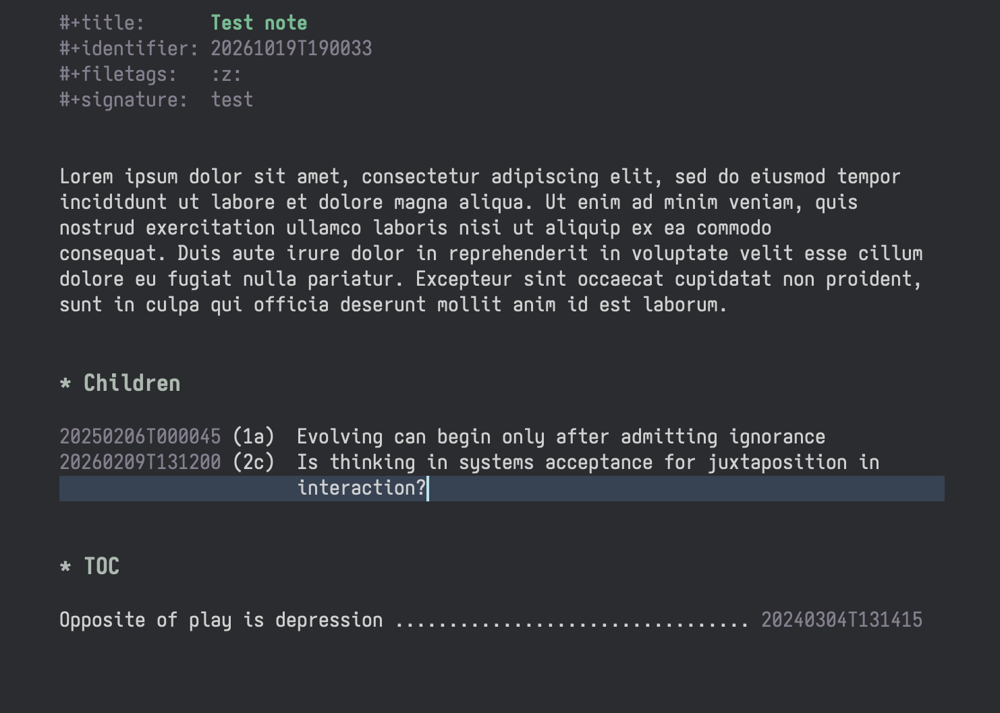

* barezettel.el - Minimalistic Emacs Zettelkasten minor mode for Denote

The core idea behind this package is to let you use Denote without the visual clutter caused by Org links and =denote:= prefixes when rendering is neither desired nor available. In other words, you can use bare Denote IDs in your notes and have them function as links. This makes plain-text note files much more pleasant to read outside Emacs.

Barezettel makes detected Denote IDs interactive. Just hit =M-RET= on the ID and you will be provided with a completion list of all the notes containing the ID to pick from. This /"link as search"/ functionality might be familiar to you from [[https://zettelkasten.de/the-archive/][The Archive]] app.

*This package is under early stages of development. Expect breaking and sudden changes in directions it will go. Right now the development is driven by needs dictated by my personal Zettelkasten workflow.*

** What does it look like?

** Features

- Jump between links in the buffer
- Open link at point following "link as search" idea
  - Defaults to completing-read prompt. With a user setting, open the targets list in a separate denote-dired buffer
- Expand ID at point with its corresponding title
- Insert a link also in form of a TOC line
- Extract a region to a new note and replace the original region with the new note's ID
- Visual hanging indents which extend the =visual-wrap-prefix-mode=: text following two spaces in the beginning of a line is treated as a prefix – hanging indents are constructed accordingly. This allows treating IDs as list markers
- Aforementioned hanging indents support for =M-q= (=fill-paragraph=) and =auto-fill-mode=
- Open a random Denote note

** Installation

#+begin_src elisp
  (use-package barezettel
    :ensure t
    :vc (:url "https://github.com/jwayston/barezettel"
         :rev :newest)
    :bind (("C-c n x" . #'barezettel-denote-append-title-at-point)
           ("C-c n X" . #'barezettel-denote-extract-region-and-link)
           ("C-c n l" . #'barezettel-denote-link)
  	 ("C-c n t" . #'barezettel-denote-link-toc)
           ("C-c n r" . #'barezettel-denote-random-note)
           ("C-c n >" . #'barezettel-forward-id)
  	 ("C-c n <" . #'barezettel-backward-id)
  	 :map barezettel-denote-id-keymap
  	 ("M-<return>" . #'barezettel-denote-show-targets-at-point))
    :custom
    (barezettel-use-brackets-around-signature t)
    (barezettel-visual-hanging-indents t)
    (barezettel-show-targets-in-denote-dired t)
    :config
    (global-barezettel-mode t))
#+end_src

Enabling =global-barezettel-mode= toggles the =barezettel-mode= only for the buffers that are detected as Denote notes.
